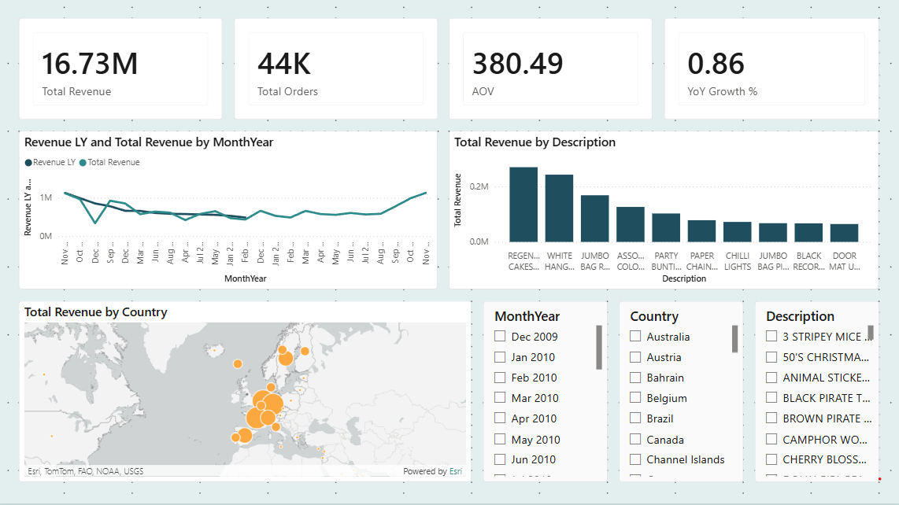
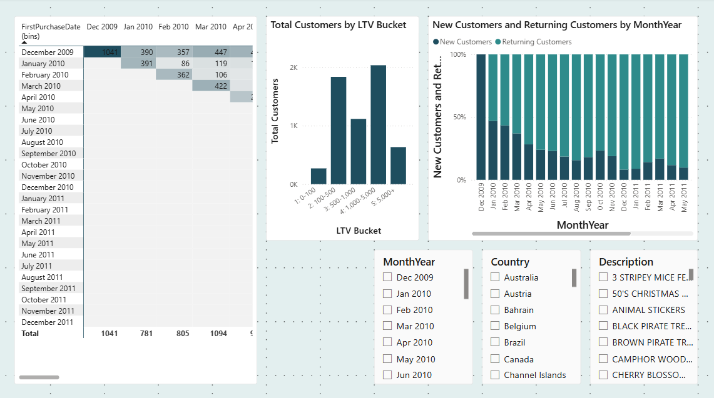
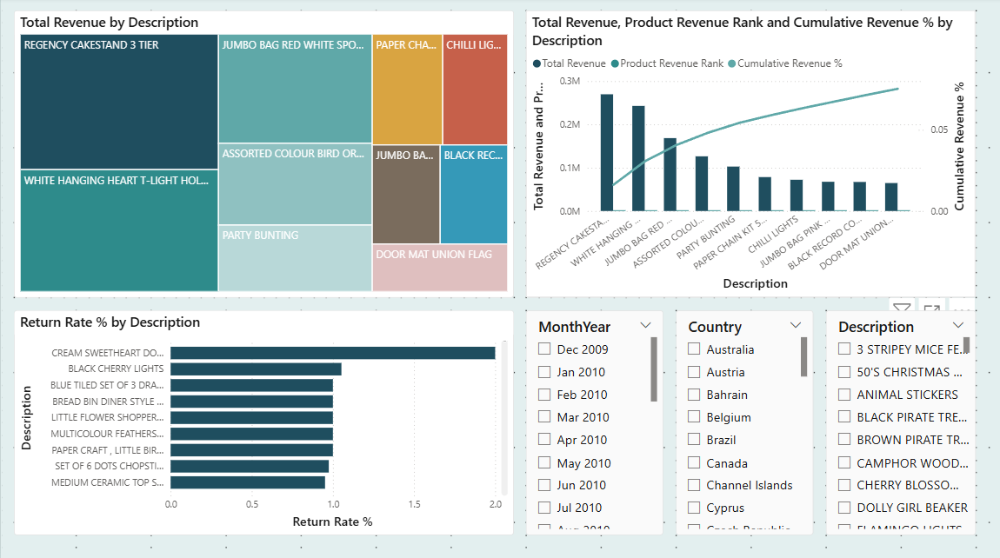

# UK Retail Sales Dashboard

A Power BI dashboard analyzing two years of transaction-level sales data from a UK-based online retailer, built to demonstrate data modeling, DAX, and dashboard design for Business Analyst / Data Analyst roles.

## What this answers

- How is revenue trending year over year, and which products and countries drive it?
- How much of the customer base is new vs. returning, and how does that shift over time?
- Which products carry disproportionate return rates, and where does revenue concentrate (80/20)?

## Data source

[Online Retail II](https://archive.ics.uci.edu/dataset/502/online+retail+ii) (UCI Machine Learning Repository), roughly 1M+ invoice line items from a UK-based online gift retailer, December 2009 to December 2011, split across two files by year.

## Structure

Star schema, one fact table and three dimension tables:

- `FactSales`: transaction line items (invoice, product, quantity, price, customer, country)
- `DimDate`: calendar table with a numeric sort key for correct chronological ordering
- `DimCustomer`: one row per customer, with first/last purchase dates, order count, total revenue, and an LTV bucket
- `DimProduct`: one row per SKU

## Pages

1. **Executive Overview**: revenue KPIs, YoY trend, top products, revenue by country
2. **Customer Analysis**: monthly cohort retention heatmap, LTV distribution, new vs. returning customer mix over time
3. **Product Performance**: revenue treemap, 80/20 Pareto analysis, return rate by product

## Notable data issues handled

Real transactional data doesn't arrive clean. A few worth flagging:

- **Locale mismatch on dates**: the source dates are day/month/year, but Power Query's default parser assumed month/day/year and silently corrupted any date with a day-of-month over 12. Fixed by forcing an explicit `en-GB` culture on the date conversion.
- **Datetime vs. date relationship mismatch**: relating a full datetime column (with time-of-day) directly to a pure date dimension fails on nearly every row, since exact value matching rarely lands on midnight. Fixed by deriving a date-only column for the relationship.
- **Non-product line items**: the raw data mixes real SKUs with administrative codes (postage, manual price adjustments, bank charges, discounts). Left in, these distort return-rate and revenue-concentration analysis, so they're filtered out at the source.
- **Return rate distortion on low-volume products**: dividing returns by net revenue (which already nets out negative-quantity return rows) produces meaningless spikes for products with few original sales. Fixed by calculating rate against gross (pre-return) revenue, with a minimum sales-volume floor before reporting a rate at all.

## Files

- `UK-Retail-Sales-Dashboard.pbix`: the dashboard
- `docs/power-query-m.txt`: full Power Query (M) transformation scripts
- `docs/dax-measures.txt`: all DAX measures
- `docs/retail-dashboard-theme.json`: custom Power BI theme

## Screenshots

| Overview | Customer Analysis | Product Performance |
|---|---|---|
|  |  |  |

## Tools

Power BI Desktop, Power Query (M), DAX
